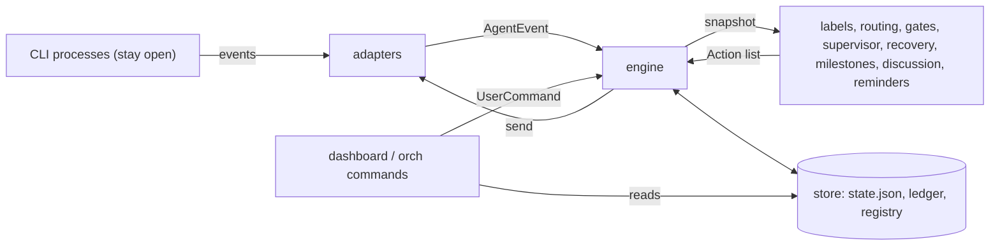
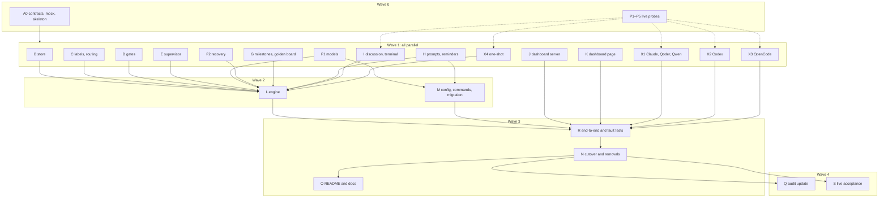

# Orch redesign: requirements, design and work plan

Version of 2026-11-25. This is the document to build from. The discussion behind it, with the evidence, is in
`assets/ORCH-ISSUES.md`; where the two differ, this document holds, except that an agreed decision missing here is a
mistake to report, not a decision to drop.

Nothing here is implemented yet.

| Part | For |
|---|---|
| 1 Goals and terms | everyone |
| 2 Requirements (with ids) | everyone; a package implements the ids it lists |
| 3 Architecture and contracts | everyone |
| 4 Work topology | the coordinator, and each sub-agent for its own package |
| 5 Live probes | packages P1–P5 and the adapters |
| 6 Assumptions and open points | the user |
| 7 Traceability | reviewers |

---

# 1. Goals and terms

## 1.1 Goals

1. A message reaches its recipient at once, and the record shows what became of it.
2. The dashboard shows what is really running.
3. Work never stops unnoticed: every dead end reaches the manager and then the user.
4. A failure, a model switch or an Orch restart loses no work and sends nothing twice.
5. Finished work always passes the critic.
6. Prompts are short, natural, current and free of contradictions.

## 1.2 Not goals

- No fixed workflow: steps show progress and control nothing.
- No hard limits on files: no file locks, no conflict warnings, no read limits for workers.
- No automatic restart of Orch itself. Agents and jobs stop if the computer shuts down.
- No review file, no pipeline mode, no controller (`llm`) mode, no separate parallel mode.

## 1.3 Terms

| Term | Meaning |
|---|---|
| Agent | manager, critic, worker, monitor or auditor. `verifier` in the code is the critic. |
| Upper level | worker → critic → manager → user. An agent knows only its own upper level, which it sees as its user. |
| Session | one conversation kept by a CLI. |
| Turn | one answer of an agent, from the first input to the CLI's end-of-turn event. |
| Intermediate / final ending | a turn that ends with a job running / with none running. |
| Job | a command the worker started with its CLI's own background option. |
| Choice | backend + provider + model + effort. |
| Session key | backend + provider address; choices with the same key are expected to continue one session. |
| Gate | something on the dashboard that waits for the user. |
| Answer gate | question, pause, plan approval or milestone approval. |
| Operational gate | opened by Orch for a failure or a limit (also counts as a pause). |
| Silent | nothing is active (2.6). |

---

# 2. Requirements

## 2.1 Messages (MSG)

- **MSG-1 At once.** Each agent's CLI stays open and Orch sends every message immediately, also while the agent writes.
  There is no queue, no replacement of waiting messages, and no `additive` or `urgent`.
- **MSG-2 Exceptions.** A message waits only while: the user's answer gates are incomplete (GATE-4) or the reply it came
  from holds a question (GATE-2); a terminal is open on the recipient (TERM-4); Orch is closed; the send failed; the
  recipient is being switched (MOD-6); or the program cannot take input while running (`command` programs, and any CLI
  whose probe fails), in which case it goes out when the turn ends.
- **MSG-3 Record.** Every message has an id, sender, recipient, text, time, status and cause. Statuses: `waiting`,
  `delivered`, `answered` (the recipient started answering), `failed`. Message status is separate from agent status.
- **MSG-4 No answer needed.** Messages to the user, and notices, end at `delivered` and never count against silence.
- **MSG-5 Unanswered.** If the recipient has not started answering 5 minutes after sending, Orch checks whether the
  message arrived and sends it again once if not. Still nothing → the agent failed (REC-1).
- **MSG-6 Send once.** Save the intent to send, with the message id, before sending. After a restart, check whether it
  arrived before sending again.
- **MSG-7 Order.** Messages to one agent enter its one conversation in order. Each names its sender where the recipient
  may know it (the critic sees worker ids).
- **MSG-8 Unknown or closed worker.** Reject, and tell the sender the available ids. With no workers, the manager asks
  the user.
- **MSG-9 Direct messages to a worker.** The manager may write to a worker (never prompted), and the user may. The critic
  is shown them as its own user's instruction.
- **MSG-10 Clean text.** `:codex-file-citation{…}` codes become plain paths before text is passed on.

## 2.2 Labels and routing (LAB)

| From | To | How |
|---|---|---|
| User | Manager | chat; gate answers together once all answer gates are closed |
| Manager | User | untagged text, `<summary>`, `<question>`, `<pause>` |
| Manager | Critic | `<message to="critic">` |
| Manager | Worker | `<message to="worker-2">`; allowed, never prompted |
| Critic | Manager | untagged text, wakes the manager at once; nothing with `<silent/>` |
| Critic | Worker | `<message to="worker-2">` |
| Worker | Critic | the whole reply |
| Monitor | Critic | only an unhealthy check |
| Orch | Worker | wakeup fallback, recovery notices |
| Orch | Manager | silence check, checklist complete |

- **LAB-1 Critic labels.** Only `<message to="…">` and `<silent/>`. Removed: `<question>`, `<pause>`, `<wait-job>`,
  `<verdict>`, `<workers>`, `<to …>`. The critic is never given a manager address.
- **LAB-2 Worker labels.** None. The whole reply goes to the critic, or to the user for a user chat (DISC-6). Worker
  `<wait-job>` is removed.
- **LAB-3 Manager labels.** `<message to>`, `<question>` (options; no `blocking` attribute), `<pause>`, `<rubric>`,
  `<score>`, `<decision>` (ACCEPT, REVISE, PAUSE), `<summary>`, `<state>`. Removed: `<workers>` and the CONTINUE
  decision. The names of other agents are display names; ids are stable.
- **LAB-4 `<silent/>`.** Means nothing in the reply needs the manager or the user. It may stand anywhere in a reply.
  Worker messages in the reply are still sent; only the untagged text is kept from the manager. The text stays visible
  on the dashboard.
- **LAB-5 Broken label.** Return it to the sender once to fix. If it fails again, pass it on marked as broken (a broken
  critic message goes to the manager).
- **LAB-6 Direction of a worker reply.** A reply started by the critic, a job, Orch or other work goes to the critic,
  also when the user wrote during it. A reply started only by the user's message goes to the user, with a *Send to
  critic* button.

## 2.3 Workers and registry (WRK)

- **WRK-1** A registry holds each worker's stable id, session, lifecycle (open, closed, deleted), status and current
  assignment. The current assignment is the latest message the critic sent it, in one line.
- **WRK-2** Only the user adds, closes, reopens or deletes workers, on the dashboard. No agent changes the number.
- **WRK-3** Reopening continues the saved session. Deleting is final for the worker, but its messages stay in the record.
- **WRK-4** Late messages never revive a closed worker.
- **WRK-5** Closing or deleting a worker with a job asks the user: let it finish, or stop it. Late results are recorded,
  not routed.
- **WRK-6** Adding or reopening shows in the critic's next reminder; it does not wake the critic.
- **WRK-7** Workers do not know about each other and nothing names one to another.
- **WRK-8 Review.** A final reply always goes to the critic. The critic assigns one query at a time (prompt only).
- **WRK-9 Parallel work.** The critic's prompt and reminder say how many workers are available, and to split work only
  into independent parts. Using one is fine.
- **WRK-10 Files.** Workers share the folder. The prompt says files may change meanwhile, not to undo others' changes,
  and to use a separate git tree if the work would clash; the worker merges it back and removes it.
- **WRK-11 Questions.** A worker that needs an answer to go on asks the critic in plain text and ends its turn. It does
  not guess or continue dependent work; independent work may go on.

## 2.4 Jobs (JOB)

- **JOB-1** Workers use their CLI's own background option. Orch reads the CLI's job record. `nohup` and the like are
  rejected as far as each CLI can enforce it; the prompt says so in any case. The old process detector is removed.
- **JOB-2** At the end of a turn Orch checks the record: a job running → *intermediate*, status `waiting for job`;
  none → *final*, ready for review.
- **JOB-3** An intermediate reply goes to the critic at once, marked "job still running, not ready for review". The
  critic may message the worker (the job keeps running) or be silent. It does not tick items that depend on the job.
- **JOB-4** When a job ends, the CLI wakes its own session and Orch catches the reply.
- **JOB-5 Fallback.** If no turn starts within about 1 minute after a job ended, Orch messages the same session ("your
  job finished, continue"), or resumes the session if the process has exited. Once per job, after checking again that
  no turn started; shown on the dashboard.
- **JOB-6** A job whose end is never reported is found by the monitor's regular check. A long job without progress is
  reported to the critic.
- **JOB-7** A job that ended without a result (crash, reboot, stop) is `lost`: wake the worker to check, unless the user
  pressed stop.
- **JOB-8** A server that never ends does not block items that do not depend on it, nor the milestone review (shown to
  the manager).

## 2.5 Steps, checklist and milestones (MS)

- **MS-1** The critic keeps steps and items in one Markdown file per milestone. A step passes by itself when its items
  are complete. No verdict, no approval per step.
- **MS-2** A missing or unreadable checklist is not complete; the critic is asked to fix it.
- **MS-3** Steps appear only in a progress panel. Messages and assignments have no step; links are optional.
- **MS-4 Review trigger.** When the checklist becomes complete, no worker is writing and no message waits, Orch tells the
  manager once; a silent last reply does not hide this. The manager chooses: review, or first answer the critic. Orch
  tells it again only after the checklist changed and is complete again. Running jobs do not block it and are shown.
- **MS-5** An ordinary critic message never starts a review. The no-progress review is removed.
- **MS-6** Rubric and scores stay as today. ACCEPT opens the milestone approval gate as today.
- **MS-7 REVISE.** The manager's message tells the critic what to fix and to update its checklist, without naming
  milestones or the review. The critic unticks or adds items for any requested change.
- **MS-8** `<decision>PAUSE</decision>` works like `<pause>`. The review runs again after it.
- **MS-9 Question in a review.** Hold ACCEPT or REVISE until all answer gates are closed; then the manager decides again.
- **MS-10 Changing milestones.** Only the user starts it, with a *Change milestones* button that adds the current list
  with ids to one message. Only the reply to that is read as a change. Format: the existing numbered list plus ids. The
  normal prompt does not mention it.
- **MS-11 Approval.** One gate shows old and new lists side by side. Applying a discussion that changes milestones
  opens the same gate. Nothing changes before approval.
- **MS-12 Limits.** Ids are fixed and never reused. Finished milestones stay (they can be reopened). The current one is
  rewritten in place with its rubric under the same id: the critic's checklist is untouched and no message is forced.
  Later ones may change; removed ones are marked dropped and kept.
- **MS-13** An open review or approval of a changed milestone is withdrawn and its rubric written again.
- **MS-14** After the last milestone the run stays open as finished: sessions kept, no silence check. Added milestones
  start like any other. Completed old runs can be reopened.
- **MS-15** `state.json` is the only store of milestones.

## 2.6 Silence, limits and failures of the flow (SIL)

- **SIL-1 Active** means any of: an agent writing; a running job; a message that needs an answer and is waiting or not
  yet answered; a job that ended and has not woken its agent; a discussion; an open gate; an open terminal; an agent
  retrying, switching or waiting for a usage limit; agents stopped by the user.
- **SIL-2** If nothing is active and the run is neither paused nor finished, Orch asks the manager to check, whether or
  not `<silent/>` was used. After 3 tries with everything still silent, Orch opens a pause gate. The count restarts when
  work restarts.
- **SIL-3** The manager works out the cause and messages the critic to continue. It asks the user or pauses only when
  the work really needs the user.
- **SIL-4 Frozen.** A manager, critic or worker marked writing, with no output for 40 minutes and no tool call or job
  running, is restarted in the same session once. Then: manager or critic → operational gate; worker → failed worker
  (REC-1, WRK failure). Not for the monitor.
- **SIL-5 Round limit.** One limit of 5000 rounds, one round being one worker reply delivered to the critic. Reaching it
  opens an operational gate. It replaces step and milestone round limits. No exchange limit; agents end exchanges with
  silence, and no extra rule for busy work without progress.

## 2.7 Gates and pause (GATE)

- **GATE-1** `<question>` opens a gate with selectable options. By itself it pauses nothing.
- **GATE-2** A reply with a question forwards nothing to the critic or to workers, whatever else it contains.
- **GATE-3** The answer returns to the manager, which then messages the critic.
- **GATE-4** With several answer gates, Orch records each answer and sends all to the manager in one message once the
  last answer gate is closed.
- **GATE-5** While gates are open the user's chat still goes to the manager, closes no gate, and the manager may message
  the critic in a reply without a question, on matters unrelated to it. The manager is reminded of open gates and does
  not ask the same again.
- **GATE-6 Pause.** `<pause>` sets the paused status and always opens a pause gate. Agents and jobs go on; the only
  effect is that silence is allowed. It ends when the user has closed all open gates.
- **GATE-7** Pause and question in one reply: both take effect. Pause and critic message without a question: the message
  is sent.
- **GATE-8** The critic cannot propose a pause.
- **GATE-9** Every pause has an open gate.

## 2.8 Discussion and terminal (DISC, TERM)

- **DISC-1** Only with the manager or the critic. The agent communicates only with the user; what it writes to others is
  a draft, including what it was writing when the discussion began.
- **DISC-2** Incoming messages and job ends enter the conversation at once.
- **DISC-3** The user applies it: one consolidated message per recipient. For the critic, its one reply follows the
  normal rules (labelled parts to workers, untagged text to the manager).
- **DISC-4** Ending without applying drops drafts, never incoming messages.
- **DISC-5** In a critic discussion nothing it writes reaches the manager.
- **DISC-6** A chat with a worker or another agent is instant: no discussion mode. Reply direction: LAB-6.
- **TERM-1** The panel shows one command to copy (`orch terminal <project> <agent>`) that opens the right CLI on the
  session, with the agent's model, effort, system prompt and settings.
- **TERM-2** For the manager and critic it starts a discussion; applied on the dashboard. Orch reads the session
  afterwards; no hook.
- **TERM-3** For others it is an instant conversation.
- **TERM-4** Messages to that agent wait until it closes. Where the terminal joins the open session (Codex, OpenCode)
  Orch need not close its copy; otherwise Orch closes and reopens it, never two CLIs on one session.
- **TERM-5** Ask first if opening it would end a running job.
- **TERM-6** The dashboard shows an open terminal, the number of waiting messages, and a take-back button.

## 2.9 Models (MOD)

- **MOD-1** A dashboard window chooses each agent's backend, provider (OpenCode), model and effort from the list in
  `.orch/settings.yaml` (edited by hand; keys never shown). It also shows and switches to the agent's backups.
- **MOD-2** Effort levels come from each CLI: Codex `model/list`; OpenCode variants (`provider/model#variant`); fixed
  levels for Claude and Antigravity; Qoder after its probe; hidden where there are none (Qwen).
- **MOD-3** Saved in `agent.yaml`, replacing the old model and effort lines and keeping other settings and comments. It
  clears any remembered backup; backups are remembered by name.
- **MOD-4** New projects start with `.orch/settings.yaml` and agents that refer to it. For existing projects Orch writes
  it from their `agent.yaml` files and keeps the old files until the user confirms.
- **MOD-5** Show the model the CLI reports, not only the chosen one.
- **MOD-6 When.** Switch when the agent is idle with no job; show "switch pending" until then. A forced switch warns that
  current work and jobs stop, then sends the unfinished message again to the new model (except SES-6).
- **MOD-7 Smoke test.** Every switch first sends a tiny request with the new choice in a temporary session. If it fails,
  do not switch and show why.

## 2.10 Sessions and handover (SES)

- **SES-1** Always try the old session first. A new one starts only if the session key differs or the CLI rejects or
  loses the session.
- **SES-2 Detection.** On the first message after a switch and at each reconnect: an explicit rejection of the session or
  its history, or a different session id. Rate limit, overload, network, billing and missing CLI are not this.
- **SES-3** One new session per switch. If that fails too, the choice itself failed (REC-1).
- **SES-4** Each agent keeps one saved session per session key. Returning to an earlier one reopens it and tells it what
  happened since.
- **SES-5 Handover**, only when a new session is needed: on a normal switch the old model writes it. If it cannot, the
  upper level reads the current progress and writes a short instruction (critic for a worker, manager for the critic).
  A new manager gets its system prompt and a pointer to its saved turns, newest first. If the one who should write it
  does not answer, an operational gate asks the user to replace models from the upper level down. No copied text.
- **SES-6** That instruction replaces only the upper level's own unanswered message; all others are sent after the switch,
  again only if they may not have reached the current session.

## 2.11 Recovery and restart (REC)

- **REC-1 Retry.** API errors: up to 5 tries with the existing waits, then backups in order, then the agent has failed.
- **REC-2** Billing and missing CLI: no retry on the same choice; straight to a backup that avoids it. With none, only
  that agent stops and a gate opens. Other agents keep running.
- **REC-3** A worker that failed after retries and switch: the critic is told (not as work to review) and the others go
  on; the critic may reassign after checking what it left. A failed critic or manager: operational gate.
- **REC-4** While a job runs: retry in the open CLI; no automatic switch to another backend until the job ends. A forced
  switch is possible.
- **REC-5** Automatic return to the main model only when the session continues.
- **REC-6** All choices fail: open a gate, smoke-test all of them every 30 minutes, close the gate when one works and is
  switched to.
- **REC-7** Orch saves per agent: session, choice, process (id and start time), output file and read position, and each
  step of a switch. After a restart it reconnects to the same process, reads what it missed, processes it in order
  (merging outdated intermediate replies), and continues an unfinished switch from its last step.
- **REC-8** Use the saved session's own backend and choice, never the agent's main one. Never open a second CLI on a
  session that is open. Keep the old session until the new one has answered.
- **REC-9** Closing Orch leaves agents and jobs running; a separate *stop agents* button stops them.
- **REC-10 Monitor.** Failure is shown; after 2 failures the critic is told nobody watches. Only unhealthy checks (quiet,
  off-track, stopped) reach the critic: once per change of status, then at most hourly. Checklist once per session, then
  only changed items.

## 2.12 Dashboard (UI)

- **UI-1** A status board: each agent `idle`, `writing`, `waiting for job`, `failed` or `closed`, from the CLI's own
  events, with its jobs, last activity, assignment, waiting messages and actual model.
- **UI-2** Messages in time order with sender, recipient, time and status; no step blocks. Steps in a panel on top.
- **UI-3** Worker controls; model window; *stop agents*; *Change milestones*; gates with options and free text; the
  discussion panel with the terminal command; *Send to critic*; open-terminal notice.
- **UI-4** The audit page has a place for the user's notes, saved in `audit-decisions.md`.
- **UI-5** The review file button, card, requests and API are removed.
- **UI-6** Old runs still open and read correctly.

## 2.13 Prompts and reminders (PRM)

- **PRM-1** Every prompt is rewritten from this document. Each rule is in one place: role prompt = what the agent does;
  protocol = labels; reminder = only what is easily forgotten. Plain, natural language; no leftovers of one project.
- **PRM-2** Projects never copy prompts; Orch's own are always used. A prompt edited by hand is moved to a backup file.
  The user manages only the golden board and the goal.
- **PRM-3** All reminders of a message form one `<system-reminder>` at its end, one short line each, no duplicates.
- **PRM-4 Frequency.** Every turn only for what is easily forgotten and harmful; everything else is a random pick, each
  item with its own probability.

| Reminder | To | When |
|---|---|---|
| Worker lines (status, assignment, unanswered report, idle since) and label examples with the ids and `<silent/>` | critic | every turn |
| Use the golden board's related rules | critic, manager | random, every few turns; and when the board changed |
| How to message the critic; open gates if any | manager | random, about every one or two turns; not in a discussion |
| Keep the golden board: add new lasting preferences and decisions, merge, remove | manager | random; also in a discussion |
| Ask in plain text and end the turn | worker | random, low |
| Writing rules (one brevity line; the rest sampled) | all | random |

- **PRM-5 Golden board.** Kept by the manager, read by the critic by path (given for a new or compacted session and when
  the board changed). Never given or mentioned to workers. Whoever assigns work writes the related rules into the
  instruction; the critic also checks finished work against them. The check that keeps manager-only text from the
  critic covers the file. The size warning stays.
- **PRM-6** Per-agent preference files and every mention of them are removed.
- **PRM-7** The ten research rules move to `assets/research-rules.md` and are added to no project automatically.
- **PRM-8** The monitor answers in at most 3 lines. The manager is told not to send messages that only acknowledge.
- **PRM-9** Review texts: full once per session, then one short line; the manager's review keeps checklist and rubric.

## 2.14 Audit (AUD), after everything else

- **AUD-1** The auditor's description of intended behavior is rewritten from this document. No audit spans the change.
- **AUD-2** Orch checks exact facts (undelivered, unanswered, missing gate, job without end); the model judges the rest.
- **AUD-3** Each new finding is checked against the turns and the user's notes; unconfirmed ones are not listed.
- **AUD-4** A text window of zero is not shown as "nothing written". The digest says which fixes the running version has.

## 2.15 Removals (DEL)

Pipeline and controller modes; the old parallel mode (`<workers>`, `<to>`, work board, `worker_worktrees`); the process
detector; held and replaced messages; check-in and urgent turns; the review file; preference files; prompt copies;
`codex exec` as a way to run Codex; the terminal hook; about 24 templates of removed controls and 9 of the old modes.

---

# 3. Architecture and contracts

## 3.1 Approach

Today's runtime is one loop of phases in one class (`orch/managed.py`, 4,935 lines, 249 methods) that starts a process
per turn. The new runtime is event-driven, and is built **beside** the old one in a new package `orch/runtime/`. The old
code keeps working until the cutover (package N), which removes it; before that only M touches old files (`config.py`,
`cli.py`), without breaking the old modes. This is what makes parallel work
possible: no two packages edit the same file.

Decision logic is pure: given a snapshot and a time, it returns a list of actions. Only the engine performs actions. So
most packages need no CLI, no network and no real time to be tested.



## 3.2 Keeping CLIs open

| CLI | Open with | Input | Output after Orch closes |
|---|---|---|---|
| Claude, Qoder (Qwen, if its probe passes) | `--input-format stream-json` | a named pipe opened read-write, so it never closes (worked in a live test) | an output file with a saved read position |
| Codex | `codex app-server --listen unix://…` | socket | read the thread again (probe P3) |
| OpenCode | `opencode serve` | HTTP | read the session again (probe P4) |
| `command`, and any CLI whose probe fails | one process per turn | waits for the turn to end | output file |

The auditor stays one process per audit.

## 3.3 Modules (`orch/runtime/`)

| Module | Content | Pure |
|---|---|---|
| `contracts.py` | data classes, enums, protocols; no logic | – |
| `adapters/` (`base`, `claude`, `codex`, `opencode`, `oneshot`, `mock`) | one open CLI: start, reconnect, send, events, jobs, interrupt, close | no |
| `store.py` | state, message ledger, agent registry, crash-safe saving, snapshot | no |
| `labels.py`, `routing.py` | parse a reply; decide recipients, holds, returns | yes |
| `gates.py` | questions, pauses, approvals, operational gates | yes |
| `supervisor.py` | silence, unanswered, frozen, wakeup, lost jobs, round limit, monitor rule | yes |
| `workers.py` | add, close, reopen, delete; questions about running jobs | yes |
| `models.py` | settings, catalog, effort, saving a choice, smoke test | partly |
| `recovery.py` | retry, backups, switch steps, handover, sessions | yes |
| `milestones.py` | list, ids, changes, checklist reading, review trigger | yes |
| `golden.py` | board reading, change and leak checks | yes |
| `reminders.py`, `texts.py`, `prompts/` | reminder choice, message texts, prompts | yes |
| `discussion.py`, `terminal.py` | drafts and applying; the command and session take-over | partly |
| `engine.py` | the event loop; performs actions; recovery at start | no |
| `board.py`, `page/` | dashboard server and page | no |
| `migrate.py` | old runs and projects | no |

Kept from today: `config.py`, `recorder.py` (turn files), `report.py`, `timeline.py`, `timing.py`, `update.py`, `tags.py`
(parsing), `boards.py` (checklist parsing), `audit.py`. Turn files keep their current fields, so old readers work.

## 3.4 Contracts

Package A0 turns this into `contracts.py` and may add fields; after wave 0 it changes only through the coordinator.

```python
MessageStatus = waiting | delivered | answered | failed
AgentStatus   = idle | writing | waiting_job | failed | closed
Lifecycle     = open | closed | deleted
Trigger       = critic | manager | worker | user_chat | job | orch | gate_answer   # what started a turn
ErrorClass    = transient | billing | missing_cli | session_lost | other
Ending        = intermediate | final

Choice(backend, provider, model, effort, model_id, options, env)     # .session_key
SessionRef(session_id, session_key, choice, cwd, last_used)
ProcRef(pid, started, endpoint, output_file, read_pos)
Job(id, agent, label, started, state: running|ended|lost, exit_code, ended, woke, fallback_sent)
Message(id, sender, recipient, body, created, status, needs_answer, hold: reason|None,
        trigger, reply_turn, attempts, sent_at, delivered_at, answered_at, error)
Agent(id, role, display, lifecycle, status, choice, actual_model, sessions: {key: SessionRef}, proc, jobs,
      assignment, writing_since, last_output, tool_running, idle_since, stopped_by_user, switch: Switch|None)
Gate(id, kind: question|pause|plan|milestone|milestone_change|operational, options, text, opened, answer, source_turn)
Switch(agent, target: Choice, forced, step, old: SessionRef, new: SessionRef|None)
Snapshot(agents, messages, gates, jobs, milestones, checklist, paused, finished, discussion, terminals, rounds, now)

# what adapters report; `pos` makes replay after a restart harmless
AgentEvent = Received(message_id) | TurnStarted | Text | ToolStart | ToolEnd | JobStarted | JobEnded
           | TurnEnded(text, status, error: ErrorClass|None) | SessionChanged | ModelReported | ProcessExited
# reported by the engine itself: SmokeResult(choice, ok, why), Tick(now)

class Adapter(Protocol):
    caps: Caps                                   # sends_while_writing, reconnects, job_record, shares_terminal, compacts
    def start(self, spec, session: SessionRef | None) -> ProcRef
    def reconnect(self, proc: ProcRef) -> bool
    def send(self, message_id: str, text: str) -> None
    def arrived(self, message_id: str) -> bool | None      # None: cannot tell
    def events(self) -> Iterator[AgentEvent]               # resumes at proc.read_pos
    def jobs(self) -> list[Job]
    def interrupt(self) -> None
    def detach(self) -> None                               # Orch closes; the CLI stays
    def stop(self) -> None
    def compact(self) -> bool
    def terminal_command(self) -> list[str]
    def catalog(self) -> list[ModelInfo]                    # models with their effort levels, where the CLI lists them

# what pure modules return and the engine performs
Action = Send(message) | Hold(message, reason) | Reject(message, why) | ReturnToSender(turn, problem) | ToUser(text)
       | OpenGate | CloseGate | SetPaused | Retry(agent, after) | StartSwitch | AdvanceSwitch | RestartSession
       | SmokeTest(choice) | SaveChoice(agent, choice) | WakeWorker(job) | MarkLost(job)
       | AskManagerToCheck | NotifyReviewReady | Tell(agent, notice) | CountRound

class Module(Protocol):
    def decide(self, snap: Snapshot, event: AgentEvent | UserCommand | Tick) -> list[Action]
```

Message texts are never written inside a logic module: an action carries a text key and its values, and the engine renders
it with `texts.py` (H). A0 defines the first list of keys; a package that needs another asks the coordinator.

`UserCommand` covers every dashboard and CLI action: chat, gate answer, worker add/close/reopen/delete, choose model,
force switch, stop agents, discussion start/apply/end, terminal open/close, change milestones, send to critic, audit
notes. Dashboard API: `GET /api/state` returns the snapshot as JSON; `POST /api/command` takes one `UserCommand`.

## 3.5 Order of one event

1. The adapter reports an event; the store saves it with its position.
2. The engine builds a snapshot and asks, in this order: recovery, labels and routing, gates, discussion, milestones,
   supervisor. Later ones see the actions before them, and a hold from an earlier one is final.
3. Actions are saved as intents, performed, and marked done. On restart, intents without a done mark are checked
   (`arrived`) before they are performed again.
4. A tick every few seconds drives timers. All times come from an injected clock.

## 3.6 Rules that keep packages compatible

- Python 3.9; no new dependencies.
- A package edits only its own files. A needed change elsewhere is requested from the coordinator.
- No package imports another package's module except `contracts.py` and the kept modules; tests use the mock adapter
  and hand-made snapshots.
- New tests are `tests/test_rt_<package>.py`. Each requirement id a package lists appears in at least one test name or
  docstring.
- Live tests never run in the normal suite (`ORCH_LIVE=1` only) and never touch the user's projects or processes.

---

# 4. Work topology

## 4.1 Overview



- **Critical path:** A0 → B/F2 → L → R → N → Q and S. Give these to the strongest sub-agents.
- **Contention:** only `contracts.py` (A0, then the coordinator), `engine.py` (L) and the cutover (N) are single-owner
  bottlenecks. Everything in wave 1 is independent.
- **A probe does not block wave 1:** an adapter is written against its CLI's documented behavior with the probe result
  applied when it arrives; a failed probe only sets a capability to false (MSG-2).

## 4.2 Packages

"Owns" lists the only files the package may create or change (tests included, named `tests/test_rt_<id>*.py`).
Size is relative: S small, M medium, L large.

### Wave 0

| Id | Work | Owns | Needs | Size |
|---|---|---|---|---|
| A0 | Contracts (3.4), package skeleton, mock adapter that can script every event, fake clock and snapshot builders for tests | `runtime/__init__.py`, `contracts.py`, `adapters/__init__.py`, `adapters/base.py`, `adapters/mock.py`, `tests/rt_helpers.py`, `pyproject.toml` (also declares `prompts/` and `page/` as package data) | – | M |
| P1–P5 | Live probes (part 5), independent of each other | `docs/probes/<cli>.md` | – | S each |

Done when: `tests/rt_helpers.py` lets a wave 1 agent write a test in ten lines; the old suite gives the baseline (4.5).

### Wave 1

| Id | Implements | Owns (`orch/runtime/`) | Size |
|---|---|---|---|
| B store | MSG-3, 4, 6; WRK-1, 3, 4; REC-7, 8 (saving); MS-15 | `store.py` | L |
| C labels, routing | LAB-1…6; MSG-7…10; GATE-2 (holds); JOB-3 (marking); WRK-8 | `labels.py`, `routing.py` | M |
| D gates | GATE-1, 3…9; MS-8, 9, 11 (gate part) | `gates.py` | M |
| E supervisor, workers | SIL-1…5; MSG-5; JOB-2, 5…8; REC-10; WRK-2, 5, 6 | `supervisor.py`, `workers.py` | M |
| F1 models | MOD-1…5, 7 | `models.py` | M |
| F2 recovery | REC-1…6, 8; SES-1…6; MOD-6 | `recovery.py` | L |
| G work state | MS-1…7, 10, 12…14; PRM-5 (reading, leak check) | `milestones.py`, `golden.py` | M |
| H prompts | PRM-1, 3…9; WRK-7, 9…11 (texts); SIL-3 (text); JOB-1 (text) | `prompts/`, `texts.py`, `reminders.py`, `assets/research-rules.md` | L |
| I discussion, terminal | DISC-1…6; TERM-1…6 | `discussion.py`, `terminal.py` | M |
| J dashboard server | UI-1…6 (data and API), UI-4 | `board.py` | M |
| K dashboard page | UI-1…5 (page) | `page/` | L |
| X1 | adapter for Claude, Qoder, Qwen; JOB-1, 4 | `adapters/claude.py` | L |
| X2 | adapter for Codex app-server; JOB-1, 4 | `adapters/codex.py` | L |
| X3 | adapter for OpenCode server; JOB-1, 4 | `adapters/opencode.py` | L |
| X4 | `command` and Antigravity, one process per turn | `adapters/oneshot.py` | S |

Done when, for each package: its own tests pass without any CLI or network, and every listed id has a test. The full
suite is not part of a package (4.5). Adapters use recorded event streams, and a live test behind `ORCH_LIVE=1`.

H needs the most judgment: it must be reviewed as text, by reading the assembled prompt of each role (new session, normal
turn, after a gate, after a switch), not only by tests. Aim for clearly shorter system prompts than today's critic
(12,500 characters) and manager (10,500).

K is one page split into files, so it can be given to one agent, or to two (status, workers, models / messages, gates,
discussion, audit) if the split of files is fixed first.

### Wave 2

| Id | Work | Owns | Needs | Size |
|---|---|---|---|---|
| L engine | Event loop, performing actions, intents, start and reconnect, JOB-4 and MSG-1, 2 end to end, REC-9 | `engine.py` | all wave 1 except J, K, X1–X3 (mock and X4 are enough) | L |
| M config, commands, migration | MOD-3, 4 files; PRM-2; `orch run/serve/stop/terminal/…`; old runs and projects; MS-14 reopening | `migrate.py`, `orch/config.py`, `orch/cli.py` | A0, F1, H | M |

L and M run in parallel. M keeps the old modes loadable until N.

### Wave 3

| Id | Work | Owns | Needs | Size |
|---|---|---|---|---|
| R end-to-end tests | All scenarios in 4.4 on the mock adapter; then the real adapters on recorded streams | `tests/test_rt_e2e_*.py` | L, M, X1–X3, J, K | L |
| N cutover | Make the new runtime the only one; DEL; remove old code and tests; keep old runs readable (UI-6); review file removal | old `orch/*.py`, old tests, `orch/prompts/`, `pyproject.toml` | R | M |
| O docs | README and current docs | `README.md`, `docs/` except `probes/` and this file | N | S |

### Wave 4

| Id | Work | Owns | Needs | Size |
|---|---|---|---|---|
| Q audit | AUD-1…4 | `orch/audit.py`, the auditor prompt | N | M |
| S live acceptance | One small real project per CLI combination the user uses; restart, switch, job, gate and terminal by hand | `docs/acceptance.md` | N | M |

## 4.3 Suggested assignment to sub-agents

Up to 8 at once:

| Agent | Wave 0 | Wave 1 | Later |
|---|---|---|---|
| 1 | A0 | B | L |
| 2 | P1 | X1 | R (with L's author not testing their own code) |
| 3 | P2, P3 | X2 | R |
| 4 | P4 | X3, X4 | N |
| 5 | P5 | F1, F2 | M |
| 6 | – | C, D, E | R |
| 7 | – | H, then G | Q, O |
| 8 | – | I, J, K | S |

Models (agreed by the user on 2026-11-25):

| Model | Packages |
|---|---|
| Opus | A0, B, F1, F2, H, L; reviews of every package |
| Sonnet | P1–P4, C, D, E, G, I, J, K, X1–X3, M, R, N, Q, S |
| Haiku | P5, X4, O |

A package whose review fails twice moves to the next stronger model.

F1 and F2 should have one author, as should C, D and E: their rules touch. J and K may be split. A reviewer who wrote none
of it checks each package against its requirement ids before merging.

## 4.4 Scenarios the end-to-end tests must cover

1. Two workers finish while the critic writes; both results arrive at once and are answered.
2. Worker starts a job, replies intermediate, is messaged, wakes itself, replies final.
3. The wakeup does not come → one fallback. The job is lost → the worker checks.
4. Everything silent → three manager checks → pause gate; work restarts → the count restarts.
5. `<silent/>` with a worker message; `<silent/>` on the reply that completes the checklist → the review is still offered.
6. Question + critic message + pause in one reply; two questions answered one by one → one message.
7. Critic uses a removed label, a broken label twice, a closed worker.
8. Orch stops between "intent saved" and "sent", and between "sent" and "done" → nothing lost or sent twice.
9. Orch stops while agents work, and while a worker is on a backup on another backend → the same session goes on.
10. Transient errors → retries → backup with a new session → handover by the critic → return to the main session.
11. Billing error on one worker: the others go on. All choices fail → gate → a choice works → gate closes.
12. Forced switch during a job; switch interrupted at each step by a restart.
13. Discussion starts while the critic writes; messages arrive; apply; end without applying.
14. Terminal open: messages wait; take back.
15. Milestones changed during a review; milestones added after the last; old completed run reopened.
16. Worker closed with a job; late result; reopened.
17. Frozen worker versus a worker in a long tool call or job.
18. Night mode (6, assumption 2).

## 4.5 Working rules

- **Baseline** (2026-11-25, commit `69c1173`, `python3 tests/run.py -j 6`): 533 tests, 527 ok, 3 skipped, 2 failed, 1
  error: `test_b9b…test_recovery_is_scoped_to_its_turn_milestone`,
  `test_board_background…test_running_assignments_do_not_borrow_another_workers_step`, and
  `test_reminders…test_no_fixed_reminder_on_consecutive_critic_reviews`. An earlier run also had one intermittent failure.
- **Tests:** develop first, test after. A sub-agent finishes a batch of work (normally the whole package), then runs only
  its related tests (`python3 tests/run.py <word>`), not after each edit. The full suite runs once per wave, by the
  coordinator, after all packages of the wave are merged; failures go back to the packages that caused them.
- **Branches:** one integration branch; each package works in its own git worktree and branch from it and is merged by
  the coordinator after review. This document must be committed first, as worktrees see only committed files. No push
  without the user's word.
- **Reports:** a package ends with: ids done, test results, contract changes asked for, anything unsure.
- **Design questions** go to the coordinator, who asks the user only when this document does not settle it.
- **Contract change:** the coordinator edits `contracts.py`, notes it, and tells the packages that use it.
- **Cutover safety:** stop runs first; N is one merge that can be reverted; a project's old files are kept as backups.

---

# 5. Live probes

Each runs in a temporary folder with a cheap model, never in the user's projects, and writes facts, commands and versions
to `docs/probes/<cli>.md`. Known so far: section "CLI support" in `assets/ORCH-ISSUES.md`.

| Id | CLI | Questions |
|---|---|---|
| P1 | Claude | Message while writing; failed, several and hours-long jobs; does a job survive an API error; error when a session cannot continue; different `*_BASE_URL`; preventing `nohup` |
| P2 | Qoder | As P1; receipt echo; reconnect; model switch in one session; where effort levels are listed |
| P3 | Codex | Self wakeup; message while writing; several connections on one server, and reading what was missed; terminal joining; job survives; session error |
| P4 | OpenCode | Message while writing; reconnect; provider switch in one session; variant list; terminal joining; session error |
| P5 | Qwen, Antigravity | Does input stay open for several messages; jobs; sessions. If not, they run one process per turn |

---

# 6. Assumptions and open points

Assumptions made to close gaps. Except for 1, the user has not confirmed them one by one and may change any.

1. **Operational gates and answers** (agreed by the user on 2026-11-25): once all answer gates are closed, the answers go
   to the manager, even if an operational gate is still open. A pause still ends only when every gate is closed.
2. **Night mode** stays as today: a question is recorded with the manager's own recommendation, opens no waiting gate,
   and holds nothing back.
3. **Milestone start** keeps today's `fresh_session` option (compact, new, never), done only when the agent is idle with
   no job.
4. **In a discussion** `<question>`, `<pause>` and `<decision>` have no effect until it is applied.
5. **`orch stop`** closes Orch and leaves agents running; `orch stop --agents` stops them.
6. **`safety_timeout`** is dropped in favor of the frozen rule (SIL-4); a set value is ignored with a notice.
7. **Decisions register, handover notes in `state.md`, costs and search** stay as today.
8. **A run started under the old protocol** is migrated when it is next started: sessions kept, waiting messages sent as
   new ones, milestones given ids. No run is migrated while running.

Approved by the user on 2026-11-25: the live probes P1–P5, and local commits on an integration branch (`redesign`)
without a push. Assumption 1 is agreed.

---

# 7. Traceability

| Record in `assets/ORCH-ISSUES.md` | Here |
|---|---|
| 1 Messages do not activate workers; Immediate messaging | MSG, LAB-5 |
| 2 Dashboard status; Status board | UI-1, 2; MSG-3; SIL-1 |
| 3 Workers bypass review; Worker review | WRK-8 |
| 4 Reminders | PRM-3, 4 |
| 5 Worker identity | WRK-1…6 |
| Critic protocol; Critic silence | LAB-1, 4, 5; SIL-1, 2; MSG-5 |
| Step management | MS-1…3; UI-2 |
| Manager protocol; Question gates and pauses | LAB-3; GATE |
| Worker questions; Worker job tracking | WRK-11; JOB; REC-9 |
| Monitor rule | REC-10; PRM-8 |
| Communication map | 2.2 |
| Cases 1–5 | MS-4; JOB-8; LAB-4; SIL-5; SIL-1 |
| Cases 6–11 | GATE-5; GATE-2; GATE-7; MS-9; GATE-4; GATE-5 |
| Cases 12–18 | LAB-5; MSG-8; MSG-1; MSG-1; PRM-4; MSG-9; DISC-2, 4 |
| Cases 19–26 | REC-3; JOB-7; WRK-5; WRK-6; REC-7; REC-10; MS-2; REC-10 |
| Cases 27–32 | SIL-4; SIL-5; SIL-2; MS-4, 5; REC-1, 2; 1.2 |
| When everything is silent; When the manager reviews | SIL-3; MS-4…7 |
| Dashboard model selection | MOD; SES |
| Recovery review | REC; SES; MOD-3, 5, 7 |
| Parallel workers | WRK-9, 10; REC-3; DEL |
| Discussion and simultaneous messages; Terminal command | DISC; TERM; LAB-6; MSG-7 |
| Changing milestones | MS-10…15 |
| Clean and short prompts; template review | PRM; MSG-10; SIL-4; DEL |
| Removing the review file | UI-5; DEL |
| Updating the audit | AUD; UI-4 |
